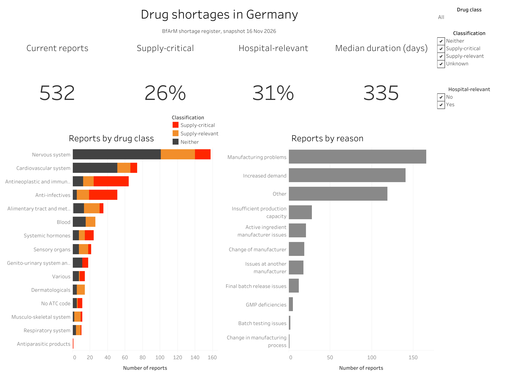
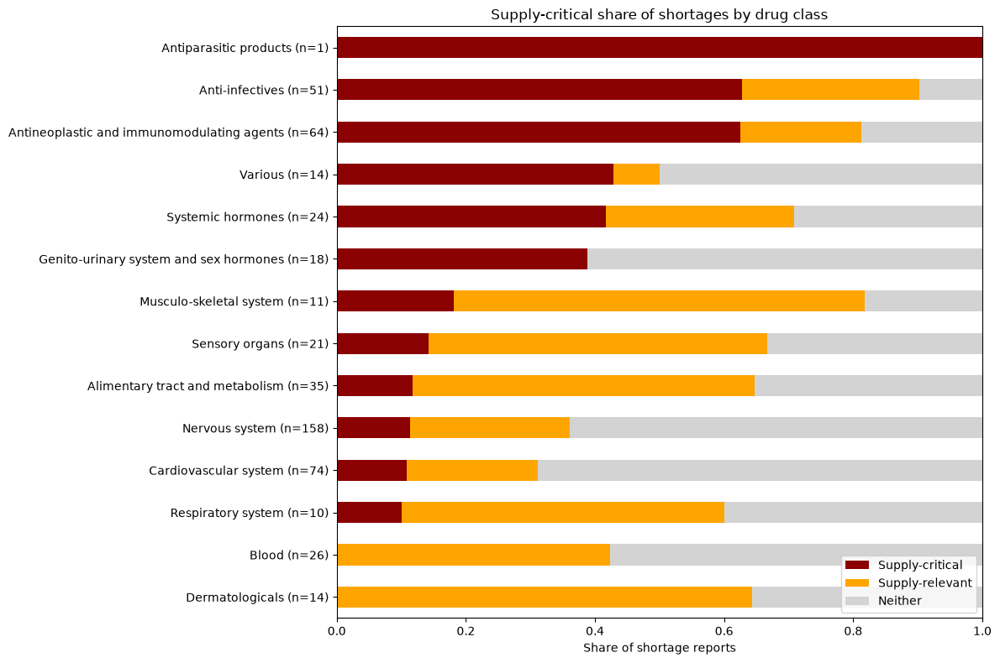
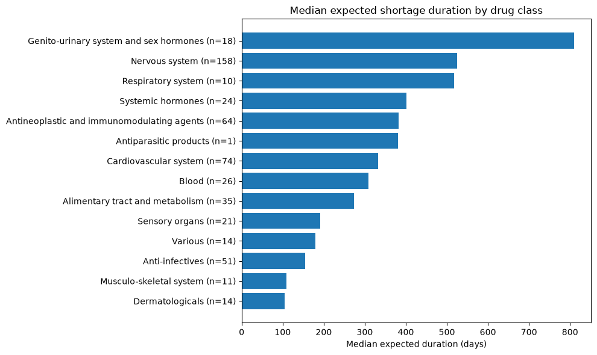

# Drug Shortage Tracker (Germany)

A daily tracker and analysis of drug shortages in Germany, based on the official shortage register of the Federal Institute for Drugs and Medical Devices (BfArM).

**Interactive dashboard:** [Drug shortages in Germany on Tableau Public](https://public.tableau.com/views/DrugshortagesinGermany/Dashboard)



## What this project does

1. **Collects data every day.** A GitHub Action downloads the BfArM shortage list each morning, removes contact data, and commits a dated snapshot to `data/snapshots/`. BfArM only publishes the *current* list, so this builds a history that cannot be downloaded later.
2. **Cleans the newest snapshot** (`src/01_load_and_clean.ipynb`): English column names and values, dates, placeholder codes set to missing, ATC drug classes, and one row per shortage report.
3. **Analyses it in Python** (`src/02_analysis.ipynb`): drug classes, reasons, expected duration, severity, and companies.
4. **Repeats the key results in SQL** (`src/03_sql.ipynb`) with DuckDB, and checks every SQL result against pandas.
5. **Shows it in an interactive dashboard** on Tableau Public, with filters by drug class, classification and hospital relevance.

## Key findings (snapshot 16 Nov 2026)

There are **532 current shortage reports**, covering 936 packages.

- **Nervous system drugs have by far the most shortages:** 158 reports, 30% of the total. Cardiovascular drugs (74) and cancer and immune drugs (64) follow.
- **The most frequent shortages are not the most serious.** Only about 11% of nervous system shortages are classified as supply-critical. For anti-infectives (51 reports) and cancer drugs (64), the share is over 60%.
- **Overall severity:** 26% of reports are supply-critical, 28% supply-relevant, and 46% neither. 31% are relevant for hospitals.
- **Reasons:** 44% are production problems. "Increased demand" is the second most common single reason. "Other" is large and unspecific, so for about 1 in 4 reports the reason is unclear.
- **Duration:** the median expected duration is 334.5 days, about 11 months. Nervous system shortages last longer (median about 520 days). Anti-infective shortages are shorter (about 150 days) but more often critical.
- **Companies:** the 10 companies with the most reports are all generic manufacturers. Several belong to the same parent company (for example, Hexal and 1 A Pharma belong to Sandoz), so a ranking by parent company would differ.

| Shortages by drug class and severity | Expected duration by drug class |
|---|---|
|  |  |

## Data

- **Source:** [BfArM shortage register (Lieferengpassmeldungen)](https://anwendungen.pharmnet-bund.de/lieferengpassmeldungen/faces/public/meldungen.xhtml), CSV download at `https://anwendungen.pharmnet-bund.de/lieferengpassmeldungen/public/csv`
- **Unit of analysis:** one shortage report. The raw file has one row per package, and one report can cover several package sizes, so counting rows would overcount shortages by about 75%.
- **Drug classes:** the first letter of the ATC code, mapped to the 14 WHO ATC main groups.
- **Privacy:** the raw file contains phone numbers and email addresses of company contacts. These columns are dropped before anything is saved or committed.

## Methods

- **Cleaning checks:** every translation of a German value uses an assert that all raw values are known, so a new category in a future snapshot stops the notebook instead of silently becoming missing.
- **Data quality fixes:** package number `0` and ATC placeholders (`TERM_ID_NA_…`, `XXXXXXX`) are treated as missing. One company name with spaced letters ("H e x a l") was corrected.
- **SQL cross-checks:** each DuckDB query is compared with the pandas result using `pd.testing.assert_series_equal`. The checks found two real differences, both now handled:
  - SQL `CASE WHEN` counted a missing classification as "not critical", while pandas skipped it.
  - DuckDB rounds 0.625 up and pandas rounds it to even, so comparisons use unrounded values.
- **SQL features used:** `GROUP BY`, conditional aggregation (`AVG(CASE WHEN …)`), `JOIN` with `HAVING`, CTEs and window functions (`RANK() OVER (PARTITION BY …)` with `QUALIFY`).

## Limitations

- **Expected, not actual, duration:** for ongoing shortages, the end date is the expected end. 16 reports have an end date in the past (probably not updated), and 2 use 1 Jan 2030 as a placeholder.
- **Missing values:** 11 reports have no ATC code, and 1 has no classification.
- **Small groups:** some drug classes have few reports (antiparasitics: 1), so their shares and medians are unreliable.
- **One snapshot so far:** the analysis uses the newest snapshot. The numbers change daily, so they are always given with the snapshot date. An analysis over time (new and ended shortages per week) is planned once enough snapshots exist.
- **The dashboard is not live:** Tableau Public stores a copy of the data at publishing time. It is updated by republishing.

## Project structure

```
.github/workflows/snapshot.yml   daily download (05:17 UTC) and commit of the snapshot
src/fetch_snapshot.py            downloads the CSV, drops contact columns, saves a dated snapshot
src/01_load_and_clean.ipynb      cleans the newest snapshot, builds package and report tables
src/02_analysis.ipynb            charts and findings
src/03_sql.ipynb                 DuckDB queries with pandas cross-checks
data/snapshots/                  daily snapshots (shortages_YYYY-MM-DD.csv)
data/processed/                  cleaned tables (parquet) and the CSV for Tableau
reports/figures/                 saved charts
```

## How to run

1. Create an environment with Python 3.12 and install the packages: `pip install -r requirements.txt`
2. Get a snapshot: `python src/fetch_snapshot.py` (or use the ones in `data/snapshots/`).
3. Run the notebooks in order: `01_load_and_clean.ipynb`, `02_analysis.ipynb`, `03_sql.ipynb`

## Stack

Python, pandas, DuckDB (SQL), matplotlib, Tableau Public, GitHub Actions
